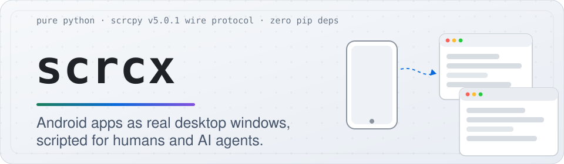

<div align="center">

<picture>
  <source media="(prefers-color-scheme: dark)" srcset="docs/banner-dark.svg">
  
</picture>

[](LICENSE) [](#) [](#) [](https://github.com/Genymobile/scrcpy) [](https://github.com/franklinatongo-code/android-mirroring/stargazers)


```zsh
./bin/scrcx app-window yt insta dc             # three apps, three resizable windows
./bin/scrcx see                                # screenshot + OCR → tap-ready coordinates
./bin/scrcx tap --text "Sign in"               # tap the thing, not the pixels
./bin/scrcx rewind --ago 90 --save before.png  # time machine over the last 5 minutes
./bin/scrcx unlock --pin <pin> --stealth       # unlock without the screen ever showing
```

*46 s demo with sound: [docs/demo.mp4](docs/demo.mp4)*

</div>

---

## Why

Your phone is the best touchscreen computer you own, and the worst mouse-and-keyboard machine
you own. scrcx fixes that: apps float out of the phone into real windows, and every action a
human can make — see, tap, type, scroll, drag, unlock — becomes a composable terminal command
with plain JSON answers. That makes it the perfect hands for an AI agent driving your phone,
or for your own tired hands after 6 pm.

- **App windows** — one or many apps as flex-resizable desktop windows, at real display resolution
- **See → act loop** — `see` returns OCR words with coordinates you can pass straight to `tap`
- **Time machine** — a 5-minute ring buffer on the PC; rewinds to any moment in 0.2 s
- **Full audio** — phone sound on your speakers, phone mic or media to a file, camera as a window
- **Zero pip deps** — Python 3 stdlib only; `adb`, `ffmpeg`, `tesseract` are the only outside tools

## Feature map

| Command | What you get |
| --- | --- |
| `app-window yt insta dc` | phone apps as separate desktop windows (`--size`, `--maximize`, `--no-audio`, …) |
| `see` / `find` / `tap --text` | OCR + JSON screen understanding, click-on-text |
| `text` / `key` / `swipe` / `scroll` | full input injection |
| `clip get` / `clip set` | shared clipboard phone ↔ PC |
| `record` / `replay` | capture gestures as JSON, replay faster/slower |
| `record-video` / `audio-capture` / `audio-play` / `camera` | capture screen, sound, or camera |
| `push` / `pull` / `send-file --scan` / `file A:/x B:/x` | file transfer, phone↔PC and phone↔phone |
| `install app.apk` | sideload |
| `watch` | browser mirror over HTTP, shareable on LAN |
| `gui` / `gui-app` | point-and-click web control center / native Tk panel |
| `unlock --pin × --stealth [--wake]` | power on + PIN, screen stays black (or ends lit) |
| `action screen-on / screen-off` | display power that survives their instant-lock |
| `hud` / `timeline` / `dcaps` | battery/thermal/fps, ring depth, device codecs |
| `mirror -- <flags>` | raw stock-scrcpy passthrough for anything else |

Fuzzy app names included: `yt ig wa fb tg dc gh gm gg sn` are aliases, `whats`, `snap`,
`instgrm`, `yorutube` all resolve — dots mean raw package names.

## Quickstart

```bash
git clone https://github.com/franklinatongo-code/android-mirroring.git
cd android-mirroring
./setup.sh                 # installs adb/ffmpeg/tesseract, fetches the scrcpy-server jar
./bin/scrcx devices        # phone over USB with USB debugging on
./bin/scrcx connect        # starts the per-device daemon (video + control + ring buffer)
./bin/scrcx see
```

Python 3 stdlib only. `app-window`, `mirror`, `record-video`, `audio-*`, `camera` and `dcaps`
additionally use a scrcpy v5.0.1 client build if present; everything else runs on the bundled
server jar. Full manual: [MANUAL.md](MANUAL.md). Agent cheat-sheet: [AGENTS.md](AGENTS.md).

## How it works, briefly

scrcx speaks the exact scrcpy v5.0.1 wire protocol in pure Python: reverse-tunnel sockets to the
device, the stock server captures video + control; the PC side decodes frames, OCRs them, keeps a
ring buffer and exposes a tiny JSON HTTP API. One daemon per phone; every CLI command talks to it.

<details>
<summary><b>Wire protocol conformance (source of truth: Genymobile/scrcpy v5.0.1 server/src)</b></summary>

| piece | upstream file |
| --- | --- |
| socket order + dummy byte | `device/DesktopConnection.java` |
| device name 64-byte field | `DesktopConnection.sendDeviceMeta` |
| codec id / session / frame | `device/Streamer.java` |
| control messages | `control/ControlMessageReader.java` (types 0–22) |
| device messages (clipboard) | `control/DeviceMessageWriter.java` |
| server options | `Options.java` |
| version check | exact `5.0.1` |

</details>

<details>
<summary><b>Complete feature board (16 planned + stock-scrcpy parity)</b></summary>

| # | Feature | Where | Status |
|---|---------------------------------------------|---------------------------------------------|--------|
| 1 | Many phones in one window | `scrcx devices` + `--serial`, `scrcx app-window` | ship (CLI); SDL grid: phase |
| 2 | PC sound → phone speakers | | phase |
| 3 | PC webcam/mic → phone | reverse direction (CameraX injection) | phase |
| 4 | Copy text you see (OCR select) | `scrcx ocr --clip`, `see`, `clip set` | ship |
| 5 | Record & replay gestures | `scrcx record start/stop`, `replay` | ship |
| 6 | Performance HUD | `scrcx hud`, `see` bundle | ship |
| 7 | Many watchers / browser mirror | `scrcx watch` (MJPEG) | ship |
| 8 | HDR video | server-side pixel source | phase |
| 9 | Time-machine rewind buffer | `rewind --ago N`, `timeline` | ship |
| 10 | AI agent full control loop | `see` → `tap --text` → `see`, AGENTS.md | ship |
| 11 | Phone as extra PC monitor | v4l2/kms reverse | phase |
| 12 | KVM shared mouse/keyboard | SDL edge-transition hook | phase |
| 13 | Drag file phone A → B / push pull | `file`, `push`, `pull` | ship |
| 14 | Internet pair / open watchers | token relay | next |
| 15 | HID beyond kbd/mouse | TYPE_UHID_* wired | next |
| 16 | Parallel users / cloned phone | server multi-user API | phase |

Stock-scrcpy parity (v5.0.1): any client flag via `mirror --`, screen recording, audio capture
(AAC/FLAC/raw auto-detect), audio-only playback, camera mirroring, V4L2 sink, HID keyboard/mouse/OTG,
APK install, push + media scan, encoder/camera/app listing, screen off/on/rotate shortcuts,
virtual-display app windows — all shipped and verified.

</details>

<details>
<summary><b>Project layout &amp; verified-on-device log</b></summary>

```
android-mirroring/
├── bin/scrcx       CLI entry
├── scrcx/          adb, protocol, daemon, control, video_reader, cli, gui, desktop
├── vendor/         bundled scrcpy-server-v5.0.1 jar
└── docs/           demo.mp4 + demo.gif
```

Verified live (2026-10-27, Samsung SM-G955F / Android 13): session connect/status/disconnect,
see (full-res OCR + tap coords + battery/temp), tap/text/swipe/long_press/keys, clipboard
round-trip, 148 s ring with `rewind --ago 30`, gesture record/replay, MJPEG `/stream` HTTP 200,
push/pull/byte-verified transfers, 567 apps listed, app windows for WhatsApp/Messages/YouTube/
Chrome/Snapchat/Instagram/Discord (fuzzy names), audio to PC speakers, AAC/FLAC capture, camera,
recorded mp4, stealth unlock end-to-end, screen on/off under instant-lock, daemon self-heal.

</details>

## Contributing

Issues and PRs welcome — the codebase is small, documented, and stdlib-only on purpose.

## License

MIT — see [LICENSE](LICENSE). scrcpy is by Genymobile under Apache-2.0; this project bundles its
unmodified server jar for convenience.

<div align="center">
<br>
<sub>Built on <a href="https://github.com/Genymobile/scrcpy">Genymobile/scrcpy v5.0.1</a> · docs: <a href="MANUAL.md">MANUAL</a> · <a href="AGENTS.md">AGENTS</a></sub>
</div>
