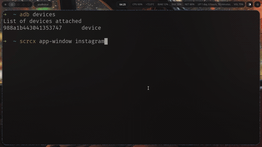

# 🎛️ scrcx — your Android apps as real desktop windows

**One Python package. Zero pip deps. Your phone on your PC — scriptable, cautious, and fast.**

   

## 🎬 See it in action

Fuzzy tokens typed → the phone's apps pop out as real desktop windows:



*(46 s full demo with sound: [docs/demo.mp4](docs/demo.mp4))*

scrcx (say "scrick-s") opens **YouTube, WhatsApp, Discord, Instagram — any app — in its own resizable
desktop window**, then gives you (and AI agents like opencode) terminal super-powers over the phone:

```zsh
$ ./bin/scrcx app-window yt insta dc              # fuzzy names, one window each
$ ./bin/scrcx see                                 # screenshot + OCR → tap-ready JSON
$ ./bin/scrcx tap --text "Sign in"                # tap the thing, not coordinates
$ ./bin/scrcx rewind --ago 90 --save before.png   # time machine: any moment, 90s back
$ ./bin/scrcx unlock --pin <pin> --stealth        # unlock with the screen never visibly on
```

## ✨ Highlights

- 🪟 **App windows** — phone apps in free-floating, flex-resizable desktop windows (virtual displays + scrcpy v5.0.1)
- 🕹️ **AI-ready control loop** — `see` → decide → `tap/text/swipe/key`; OCR words come back with *tap-ready* coordinates
- ⏪ **Time machine** — a PC-side ring buffer keeps the last 5 minutes; `rewind --ago 30` instantly
- 🔊 **Audio both ways** — phone sound on your PC speakers, or record the phone's audio to a file
- 📷 **Camera mirroring**, 🛠️ **APK install**, 📁 **push/pull/file A→B**, 📋 **clipboard sync**, 🎥 **screen recording**
- 🌐 **Watch in the browser** — MJPEG mirror shareable over LAN
- 🖱️ **Two GUIs** — point-and-click web control center, and a native Tk dashboard
- 🧙 **Daemon self-healing** — sessions auto-recover; screen on/off, stealth unlock, instant-lock safe

## 🚀 Quickstart

```bash
git clone https://github.com/franklinatongo-code/android-mirroring.git
cd android-mirroring
./setup.sh                  # installs adb/ffmpeg/tesseract, fetches the scrcpy-server jar
./bin/scrcx connect         # phone over USB, USB debugging enabled
./bin/scrcx see             # screenshot + OCR with tap-ready coordinates
```

Python 3 stdlib only — no pip packages needed. Requirements: `adb`, `ffmpeg`, `tesseract-ocr`
(installed by `setup.sh`). Optional: a local build of the scrcpy v5.0.1 **client** unlocks
`app-window` (phone apps as resizable desktop windows), `mirror`, `record-video`,
`audio-capture/play`, `camera` and `dcaps` — everything else works with the bundled server jar.

> 💡 **Fuzzy app tokens**: `yt`→YouTube, `ig`→Instagram, `wa`→WhatsApp, `dc`→Discord, `snap`→Snapchat,
> plus substrings and typos — `instgrm`, `yorutube` and `whats` all resolve. Launch several at once:
> `scrcx app-window yt insta snap whats dc`

## 📂 Project layout

```
android-mirroring/
├── bin/scrcx         CLI entry (python, no deps beyond ffmpeg+tesseract on the PC)
├── scrcx/            bridge implementation (python, stdlib only)
├── vendor/           bundled scrcpy-server v5.0.1 jar
├── tests/            offline protocol + CLI tests (no device needed)
└── MANUAL.md         full user manual, every command explained
```

## Device protocol hits upstream code

The bridge speaks the EXACT v5.0.1 wire protocol (mirrors files read from the upstream `Genymobile/scrcpy` v5.0.1 `server/src`):

| piece                        | upstream source of truth                                     |
| ---------------------------- | ------------------------------------------------------------ |
| socket order + dummy byte    | `server/.../device/DesktopConnection.java`                    |
| device name 64-byte field    | `DesktopConnection.sendDeviceMeta`                            |
| codec id / session / frame   | `device/Streamer.java` (u32 codec, 12-byte headers)           |
| control messages             | `control/ControlMessageReader.java` (types 0-22)              |
| device messages (clipboard)  | `control/DeviceMessageWriter.java` (types 0-2)                |
| server options               | `Options.java` `case "..."` keys                              |
| version check                | must send exact `5.0.1`                                       |

## Feature board (16 requested)

Numbers refer to the two feature lists agreed with the user.
Status: `ship` = implemented + verified live on device; `next` = wired but small gaps; `phase` = needs C/SDL work.

| # | Feature                                     | Where                                    | Status |
|---|---------------------------------------------|------------------------------------------|--------|
| 1 | Many phones in one window                   | `scrcx devices` + `--serial` per-device ops + grid CLI, `scrcx app-window` (per-app floating desktop windows, flex-resizable) | ship (CLI-grid + app windows); SDL window-grid: phase |
| 2 | PC sound → phone (phone as PC speakers)     | needs PC-side player on device; Planned work | phase |
| 3 | PC webcam/mic → phone (phone camera → PC: `scrcx camera`, ship) | reverse direction: CV/CameraX injection, hardest | phase |
| 4 | Copy text you see (OCR select)              | `scrcx ocr` (whole or `--box L T W H`) + `scrcx clip set` + `see` | ship |
| 5 | Record & replay clicks/gestures             | `scrcx record start/stop`, `scrcx replay` (verified) | ship |
| 6 | Performance HUD (temp/battery/fps)          | `scrcx hud`, `scrcx see` bundle           | ship |
| 7 | Many watchers / browser mirror              | `scrcx watch` (MJPEG web server, verified) | ship |
| 8 | HDR video                                   | server-side pixel source change           | phase |
| 9 | Time-machine rewind buffer                  | `scrcx rewind --ago N --save out.png`, `scrcx timeline` | ship |
| 10 | AI agent (opencode) full control loop       | `scrcx see → tap --text → see`; `AGENTS.md` | ship |
| 11 | Phone as extra PC monitor (reverse)         | v4l2/kms on PC + decode on device         | phase |
| 12 | KVM shared mouse/keyboard across devices    | SDL edge-transition hook                  | phase |
| 13 | Drag file phone A → phone B / pc push pull  | `scrcx file`, `scrcx push`, `scrcx pull` (verified) | ship |
| 14 | TeamViewer-for-phones (internet pair, open) | `scrcx watch` (--lan at connect); token relay | next |
| 15 | USB shape-shifter (HID beyond kbd/mouse)    | protocol client supports TYPE_UHID_*      | next |
| 16 | Parallel users / cloned phone               | multi-user hidden API in server           | phase |

### Normal-scrcpy feature parity (v2 update)

**Result: scrcx now natively covers the full stock scrcpy surface (v5.0.1).**

| stock feature | scrcx command | status |
|---|---|---|
| any client flag | `scrcx mirror -- <flags...>` | ship (passthrough) |
| screen recording | `scrcx record-video out.mp4 [--time N] [--max-fps F] [--max-size W]` | ship ✓ |
| audio capture (out or mic) | `scrcx audio-capture out.m4a [--mic] [--stereo]` | ship ✓ (auto codec: AAC/FLAC/raw; this device has no Opus) |
| audio-only mirror (headless speakers) | `scrcx audio-play [--record out.m4a]` | ship ✓ verified on PC speakers |
| camera mirroring | `scrcx camera --facing back [--size WxH] [--record out.mp4] [-x]` | ship ✓ |
| V4L2 fake webcam | `scrcx v4l2 /dev/videoN` | ship (needs `v4l2loopback-dkms`; graceful error without it) |
| HID keyboard/mouse / OTG | `scrcx hid [--keyboard uhid] [--mouse uhid] [--otg]` | ship |
| APK install (drag-drop) | `scrcx install app.apk [-r]` | ship |
| file push + media scan | `scrcx send-file local --scan` | ship ✓ verified |
| list encoders/cameras/apps | `scrcx dcaps encoders|cameras|apps` | ship ✓ (hw Exynos encoders + camera modes listed) |
| shortcuts (turn off screen, rotate, HUD...) | `scrcx action ...` / `key ...` equivalents | ship |
| app windows / virtual display | `scrcx app-window --size/--maximize/--fps/--bitrate/--fullscreen/--stay-awake/--on-top/--show-touches/--turn-screen-off/--pass` | ship |

scrcx extras beyond stock: `see` (OCR agent loop), `rewind`, `record/replay` gestures, `watch` web mirror, `file` A→B transfer, headless sessions with JSON API, `hud`, OCR `--clip`.

Still unique-phased (needs real dev, not wrappers): PC-sound→phone speakers (reverse audio), PC-webcam→phone, HDR, phone-as-PC-monitor, KVM edge mouse, parallel users, native C window grid.

## Verified live (2026-10-27, Samsung SM-G955F / Android 13)

- session connect (reverse tunnel), status, disconnect
- `see` — full-res OCR + tap-ready video coords + battery/temp
- `tap`, `tap --text`, `swipe`, `long_press`, `key` (vol-up/down), `action screen-on/home`
- `clip set/get` round trip against the phone's clipboard
- ring buffer: 800+ frames, 148s span, `rewind --ago 30` producing PNGs
- `record`/`replay` gesture file roundtrip (JSON steps with ms-precision)
- `watch` — MJPEG multipart stream HTTP 200
- `push` / `pull` / cross-`file` transfer verified with byte check
- `app list` — 567 packages parsed

## Survival guide

```bash
./bin/scrcx devices                      # list adb devices & sessions
./bin/scrcx connect                      # start session for the single device (or --serial)
./bin/scrcx tap 540 1200                 # tap (coords in VIDEO scale; see fixes this for you)
./bin/scrcx see                          # THE agent loop: screenshot + ocr w/ tap coords json
./bin/scrcx tap --text "Settings"        # tap whatever OCR sees as "Settings"
./bin/scrcx find "OK" --nth 1            # print nth OCR-match coords
./bin/scrcx text "hello there"
./bin/scrcx key back                     # back home power vol-up vol-down ...
./bin/scrcx api?  none                   #REST-ish direct API:
./bin/scrcx api --post '{"op":"swipe","x1":310,"y1":300,"x2":310,"y2":1000,"ms":250}'
./bin/scrcx swipe 310 300 310 1000 250
./bin/scrcx scroll 310 640 0 -1          # dy<0 scrolls down
./bin/scrcx clip get | clip set "txt"
./bin/scrcx gui                          # ← point and click control center (web GUI, localhost:8787)
./bin/scrcx ocr                          # read everything (JSON words + joined text)
./bin/scrcx ocr --box 100 200 600 300 --clip  # region only, write result to phone clipboard
./bin/scrcx rewind --ago 90 --save out.png    # 90s ago frame (ring buffer on PC)
./bin/scrcx timeline                     # how deep the buffer goes
./bin/scrcx record start my.json; ... ; record stop; scrcx replay my.json
./bin/scrcx watch                        # browser mirror URL (from session)
./bin/scrcx file 988...:/sdcard/a.jpg pc:./a.jpg
./bin/scrcx disconnect
```

Daemon: one background process per phone (`~/.local/state/scrcx/<serial>.json`). All ops talk JSON
to `127.0.0.1:PORT/api`. Wake/LAN watch stays read-only unless `--writable` watch (POST /api too).

## For AI agents

Read `AGENTS.md` — it is the cheat-sheet prompt for opencode to take over the phone.
